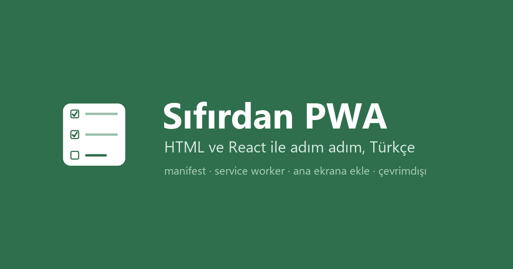
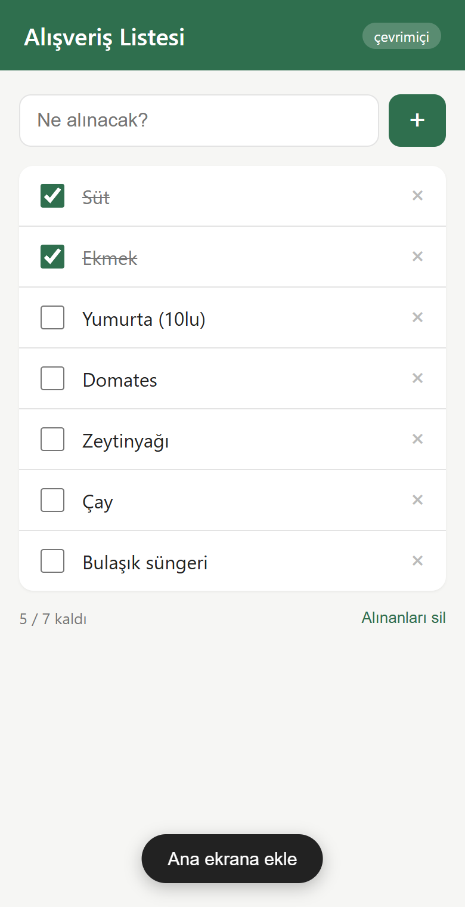
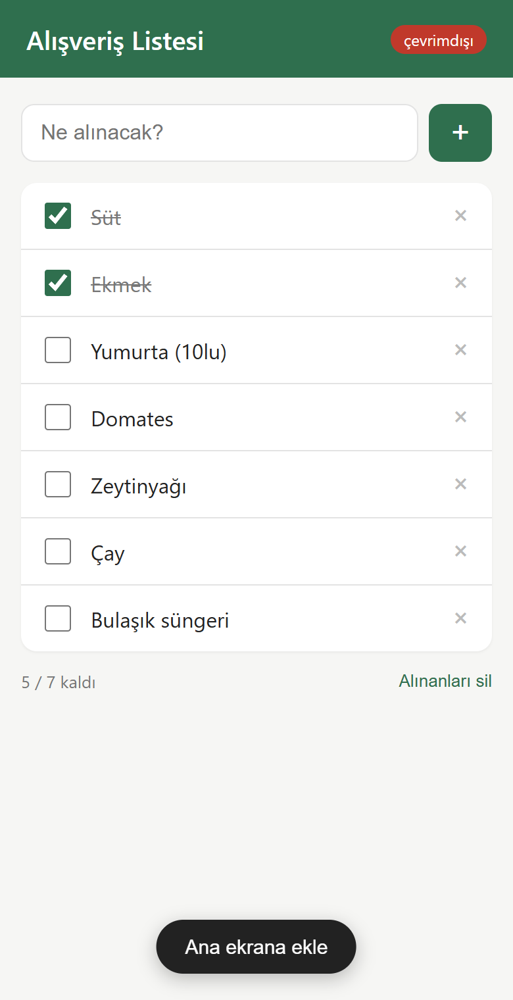
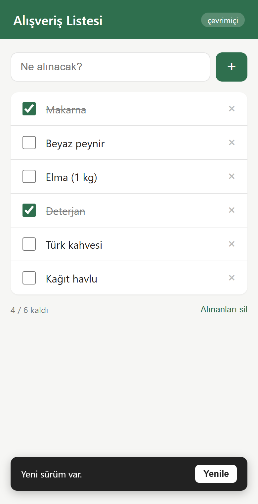

# Sıfırdan PWA



Bir web sitesini telefona "yüklenebilir" hale getirmek için ne gerekiyor, adım adım.
Önce düz HTML ile, sonra aynı şeyi React ile.

Türkçe kaynak bulamadığım için kendim not alarak öğrendim, notlar da bu repo oldu.
Örnek uygulama olarak internet yokken de çalışan küçük bir alışveriş listesi var.

> **Ekim 2026 güncellemesi.** Repo 2021'de yazıldı, anlatımlar hâlâ geçerli ama iki şey ekledim:
> aynı uygulamanın [Next.js 16 sürümü](nextjs/) ve bu işi Claude Code / Codex gibi bir ajana
> yaptırmak için hazır talimat sayfası: [docs/ai-ile-ekle.md](docs/ai-ile-ekle.md).
> Linki ajana verip "siteme entegre et" demen yeterli.

<p>
  
  &nbsp;&nbsp;
  
  &nbsp;&nbsp;
  
</p>

## PWA ne işe yarar

Site ana ekrana ikon olarak ekleniyor, açılınca adres çubuğu yok, internet yokken de
açılıyor. Kullanıcı için uygulamadan pek farkı kalmıyor. Senin için de mağaza yok, onay
beklemek yok, güncelleme anında gidiyor. Siten zaten varsa iki dosya ekleyip PWA yapıyorsun.

Bluetooth, NFC, arka planda sürekli çalışma gibi şeyler lazımsa yetmiyor, o zaman native.
Liste tutan, form dolduran, içerik gösteren şeyler için fazlasıyla yeterli.

## İçindekiler

1. [PWA nedir, ne değildir](docs/01-pwa-nedir.md)
2. [manifest dosyası](docs/02-manifest.md)
3. [service worker ve çevrimdışı çalışma](docs/03-service-worker.md)
4. [Ana ekrana ekle butonu](docs/04-ana-ekrana-ekle.md)
5. [React ile aynı şeyi yapmak](docs/05-react-ile-pwa.md)
6. [Test etmek, Lighthouse](docs/06-test-ve-lighthouse.md)
7. [Next.js ile PWA](docs/07-nextjs-ile-pwa.md) (2026)
8. [Başıma gelen sorunlar](docs/sik-sorunlar.md)
9. [Claude veya Codex ile sitene ekle](docs/ai-ile-ekle.md) (2026)

## Claude veya Codex ile sitene ekle

Projenin klasöründe Claude Code ya da Codex'i açıp şunu yapıştırman yeterli:

```
Şu sayfadaki talimatları oku ve bu projeye uygula:
https://raw.githubusercontent.com/Kadirify/sifirdan-pwa/master/docs/ai-ile-ekle.md

Uygulama adı: ......
Tema rengi: ......
Logo/ikon dosyası: ...... (yoksa mevcut favicon'dan üret)
```

Ayrıntısı: [docs/ai-ile-ekle.md](docs/ai-ile-ekle.md)

## Klasörler

```
html/    düz html + css + js, kütüphane yok, 5 dosya
react/   create-react-app ile aynı uygulama (react 17, workbox), 2021
nextjs/  next.js 16 ile aynı uygulama, 2026
docs/    anlatımlar ve görseller
```

## Çalıştırmak

HTML sürümü için bir sunucuya ihtiyaç var, dosyaya çift tıklayınca service worker çalışmıyor
(`file://` üzerinde kayıt olmuyor). En kolayı:

```
cd html
npx serve .
```

ya da Python varsa `python -m http.server 8000`. Sonra tarayıcıda `localhost:8000`.

React sürümü:

```
cd react
npm install
npm start
```

Dikkat: `npm start` ile açınca service worker **çalışmaz**, CRA bunu bilerek sadece production
build'de açıyor. Çevrimdışı davranışı görmek için:

```
npm run build
npx serve -s build
```

Next.js sürümü:

```
cd nextjs
npm install
npm run build
npm start
```

## Hangi sürümlerle yazdım

2021'deki kısımlar:

- Chrome 96, Android 11 ve iOS 15 Safari'de denedim (ekran görüntüleri masaüstü Chrome'un mobil görünümünden)
- Node 16, npm 8
- react 17.0.2, react-scripts 4.0.3, workbox 5

2026 eki: Next.js 16.4, React 19, Node 22. Chrome tarafında yükleme kriterleri arada
değişti, farklar [docs/ai-ile-ekle.md](docs/ai-ile-ekle.md) sonunda listeli.
Takılırsan [sorunlar](docs/sik-sorunlar.md) sayfasına bir bak, yoksa issue aç.

## Lisans

MIT. İstediğin gibi kullan.
