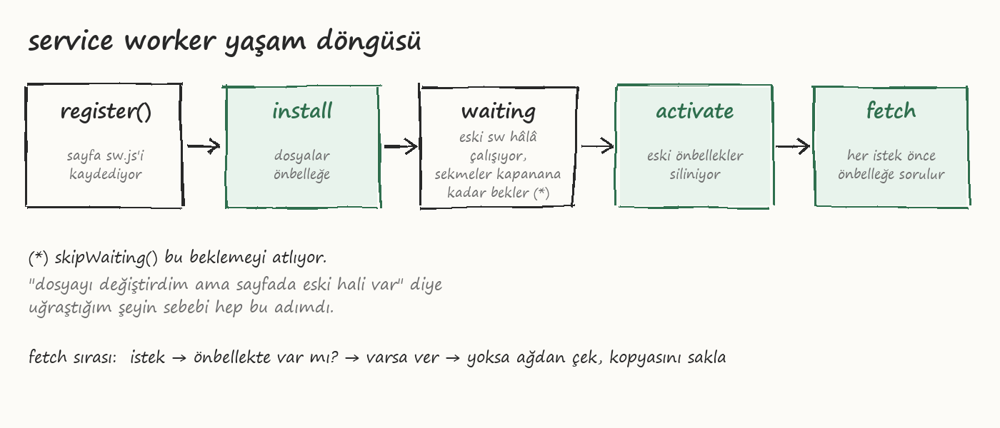

# 3. service worker ve çevrimdışı çalışma

Burası işin asıl kısmı. Manifest sadece görünüş, çevrimdışı çalışmayı sağlayan service worker.

Service worker, sayfadan ayrı bir thread'de çalışan bir JS dosyası. DOM'a erişemiyor,
`window` yok. Ama sayfanın yaptığı her ağ isteğini görüyor ve araya girip kendi cevabını
verebiliyor. Önbellekten cevap verirse ağa hiç gitmiyor, dolayısıyla internet olmasa da
sayfa açılıyor.

Repodaki hali: [`html/sw.js`](../html/sw.js), yorumlarla birlikte 65 satır.

## Kaydetmek

`app.js` içinde:

```js
if ('serviceWorker' in navigator) {
  window.addEventListener('load', function () {
    navigator.serviceWorker.register('sw.js');
  });
}
```

`load` içinde yapmanın sebebi: sayfa ilk açılırken sw'yi indirip kurmak, sayfanın kendi
dosyalarını indirmesiyle yarışmasın. Küçük bir şey ama Google öyle öneriyor.

Dosyanın yeri önemli. `sw.js` kökteyse tüm siteyi kontrol ediyor. `/js/sw.js` gibi bir
yere koyarsan sadece `/js/` altını görüyor. Buna scope deniyor ve sonradan değiştirmek
zor. Köke koy.

## Yaşam döngüsü



Üç event var, üçünü de kullanıyoruz.

### install

Sw ilk indirildiğinde bir kere çalışıyor. Burada uygulamanın dosyalarını önbelleğe alıyoruz:

```js
var CACHE = 'liste-v3';
var DOSYALAR = ['./', './index.html', './style.css', './app.js', './manifest.webmanifest', './icons/icon-192.png', './icons/icon-512.png'];

self.addEventListener('install', function (e) {
  e.waitUntil(
    caches.open(CACHE).then(function (cache) {
      return cache.addAll(DOSYALAR);
    })
  );
  self.skipWaiting();
});
```

`e.waitUntil` tarayıcıya "bu promise bitene kadar kurulum bitmedi" diyor. `addAll`
listedeki dosyalardan biri bile indirilemezse hepsi iptal, sw kurulmuyor. İyi bir şey,
yarım önbellek olmuyor. Ama dosya adını yanlış yazarsan sessizce kurulmaz, console'a bak.

`skipWaiting()` konusu aşağıda.

### activate

Yeni sw devreye girdiğinde çalışıyor. Eski önbellekleri siliyoruz:

```js
self.addEventListener('activate', function (e) {
  e.waitUntil(
    caches.keys().then(function (adlar) {
      return Promise.all(
        adlar.filter(function (ad) { return ad !== CACHE; })
             .map(function (ad) { return caches.delete(ad); })
      );
    })
  );
  self.clients.claim();
});
```

Silmezsen her sürümde yeni bir önbellek oluşuyor ve eskiler diskte kalıyor.

### fetch

Her istekte çalışıyor. Bizim strateji: önce önbellek, yoksa ağ.

```js
self.addEventListener('fetch', function (e) {
  if (e.request.method !== 'GET') return;

  e.respondWith(
    caches.match(e.request).then(function (cevap) {
      if (cevap) return cevap;
      return fetch(e.request).then(function (agCevap) {
        if (agCevap.ok && e.request.url.indexOf(self.location.origin) === 0) {
          var kopya = agCevap.clone();
          caches.open(CACHE).then(function (cache) { cache.put(e.request, kopya); });
        }
        return agCevap;
      });
    })
  );
});
```

`clone()` gerekli çünkü response bir stream, bir kere okunuyor. Birini önbelleğe koyup
diğerini sayfaya veriyoruz. Bunu unutunca "Response body is already used" hatası alıyorsun.

Başka stratejiler de var. Sürekli değişen veri (API cevabı gibi) için "önce ağ, olmazsa
önbellek" daha mantıklı. Resimler için "önbellekten ver, arkada güncelle" (stale-while-revalidate).
Bu uygulamada API yok, her şey statik, o yüzden en basiti yeterli.

## Sürüm değiştirmek

En çok takılınan yer. `style.css`'i değiştirdin, deploy ettin, sayfayı yeniledin, eski
hali duruyor. Çünkü sw hâlâ önbellekten veriyor ve önbellekte eski css var.

Çözüm: `CACHE` adını değiştir (`liste-v3` yerine `liste-v4`). Tarayıcı `sw.js`'in byte olarak
değiştiğini görünce yeni sw'yi indiriyor, install'da yeni önbelleği dolduruyor, activate'te
eskisini siliyor.

Ama bir detay var. Yeni sw indirilince hemen devreye girmiyor. Eski sw'nin kontrol ettiği
tüm sekmeler kapanana kadar "waiting" durumunda bekliyor. Yani kullanıcı sayfayı yenilese
bile eski sürümü görmeye devam ediyor, sekmeyi kapatıp yeniden açması lazım. Tarayıcı bunu
bilerek yapıyor, iki sekmenin farklı sürüm görmesini istemiyor.

`self.skipWaiting()` bu beklemeyi atlıyor, yeni sw hemen aktif oluyor. `clients.claim()`
de açık sekmeleri hemen yeni sw'ye bağlıyor. Bu küçük uygulama için ikisini de kullandım,
sorun yok. Büyük bir uygulamada riskli olabilir: sayfa eski js ile çalışırken yeni sw
devreye girer, yeni bir dosya istediğinde eski önbellekte bulamaz. React tarafında bunu
daha düzgün yaptım, kullanıcıya "yeni sürüm var, yenile" diyor. [5. bölüm](05-react-ile-pwa.md)

## Denemek

Chrome DevTools > Application > Service Workers. Burada:

- "Update on reload" işaretlersen her yenilemede sw baştan kuruluyor, geliştirirken şart
- "Offline" işaretleyip sayfayı yenile, açılıyorsa çalışıyor
- "Unregister" ile silip baştan deneyebilirsin

Application > Cache Storage altında önbelleğe ne girmiş görüyorsun.


Sağ üstteki "çevrimdışı" yazısı `navigator.onLine` ile geliyor, sw ile ilgisi yok.
`online` / `offline` eventlerini dinleyip güncelliyorum. Not: `onLine` true dönmesi
internetin çalıştığı anlamına gelmiyor, sadece bir ağa bağlı olduğunu söylüyor.
Wifi'ya bağlı ama modem kopuksa yine true. Gösterge olarak yeterli, karar mekanizması olarak değil.
