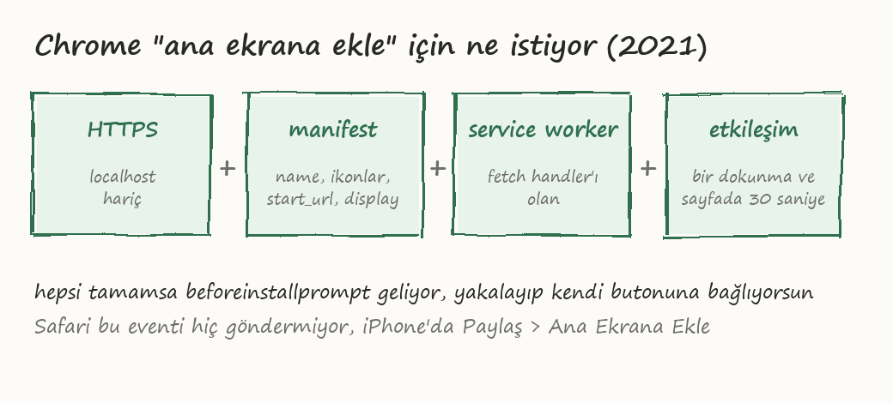

# 4. Ana ekrana ekle butonu

Manifest ve service worker tamamsa Chrome kendi kendine bir teklif gösteriyor. Android'de
alttan çıkan bir bar, masaüstünde adres çubuğunun sağında küçük bir ikon. Bunu olduğu gibi
bırakabilirsin, bir şey yapmana gerek yok.

Ama genelde kendi butonunu istiyorsun. Çünkü Chrome'un barı sayfa açılır açılmaz çıkıyor,
kullanıcı daha siteyi anlamadan. Kendi butonunla zamanı sen seçiyorsun.

## Şartlar



Chrome'un 2021 sonu itibariyle istedikleri:

- HTTPS (localhost hariç)
- manifest'te `name` veya `short_name`, `start_url`, `display` (standalone / fullscreen / minimal-ui),
  192 ve 512'lik ikonlar
- `fetch` handler'ı olan bir service worker. Boş bir `fetch` listener'ı bile yeterli
  ama Chrome bunu da yakında kaldıracakmış, gerçekten çevrimdışı çalışması gerekecek
- Kullanıcı sayfaya en az bir kere tıklamış ya da dokunmuş olmalı
- Sayfada toplam en az 30 saniye geçirmiş olmalı

Çok eskiden "iki ayrı gün ziyaret etmiş olmalı" gibi bir şart da vardı, o 2018 civarında kalktı.
Bu kriterler sürekli değişiyor, güncel liste için `web.dev/install-criteria` sayfasına bak.

## beforeinstallprompt

Şartlar sağlanınca Chrome `beforeinstallprompt` eventini fırlatıyor. Bunu yakalayıp
saklıyoruz:

```js
var bekleyenPrompt = null;

window.addEventListener('beforeinstallprompt', function (e) {
  e.preventDefault();          // Chrome'un kendi barını engelle
  bekleyenPrompt = e;          // eventi sakla
  yukleBtn.hidden = false;     // kendi butonumuzu göster
});
```

Butona basınca saklı eventin `prompt()` metodunu çağırıyoruz:

```js
yukleBtn.addEventListener('click', function () {
  if (!bekleyenPrompt) return;
  bekleyenPrompt.prompt();
  bekleyenPrompt.userChoice.then(function (sonuc) {
    console.log(sonuc.outcome);   // 'accepted' ya da 'dismissed'
    bekleyenPrompt = null;
    yukleBtn.hidden = true;
  });
});
```

`prompt()` bir kere çalışıyor. Kullanıcı reddettiyse aynı event ile tekrar çağıramazsın,
`null`'a çekip butonu gizlemek lazım. Sayfa yenilenince event tekrar geliyor, yani
kullanıcı bir kere "hayır" dedi diye buton sonsuza kadar kaybolmuyor. Her açılışta
sormak da kullanıcıyı darlıyor; gerçek bir projede reddedenleri localStorage'a yazıp bir
daha göstermemek mantıklı, bu örnekte uğraşmadım. (Chrome'un kendi alttan çıkan barı ise reddedilince uzun süre çıkmıyor,
o ayrı bir şey.)

Yüklendikten sonra `appinstalled` eventi geliyor, butonu orada da gizliyorum.

Repodaki tam hali: [`html/app.js`](../html/app.js), en alttaki bölüm.


## Yüklü mü, değil mi

Uygulama standalone açıldıysa CSS ile anlaşılıyor:

```js
var yuklu = window.matchMedia('(display-mode: standalone)').matches;
```

Buna göre "ana ekrana ekle" butonunu hiç göstermeyebilirsin. iOS'ta bunun yerine
`navigator.standalone` var.

## Safari

Safari `beforeinstallprompt` göndermiyor, hiç. iPhone'da kullanıcı Paylaş > Ana Ekrana
Ekle yapmak zorunda ve çoğu kullanıcı bunun varlığını bilmiyor. Yapabileceğin tek şey
iOS Safari'de olduğunu anlayıp küçük bir not göstermek: "Paylaş butonuna basıp Ana
Ekrana Ekle'yi seç". Bu repoda eklemedim, uygulamayı şişirmek istemedim, ama gerçek bir
projede eklersin.

iPhone tespiti için kabaca:

```js
var ios = /iphone|ipad|ipod/i.test(navigator.userAgent);
var safariIcinde = !navigator.standalone;
```

## Masaüstü

Chrome ve Edge masaüstünde de yüklüyor. Adres çubuğunun sağında bir ikon çıkıyor,
tıklayınca pencere olarak açılıyor, Windows'ta başlat menüsüne giriyor. Aynı
`beforeinstallprompt` eventi masaüstünde de geliyor, kod değişmiyor.

Firefox masaüstünde desteklemiyor, Android Firefox'ta var.
