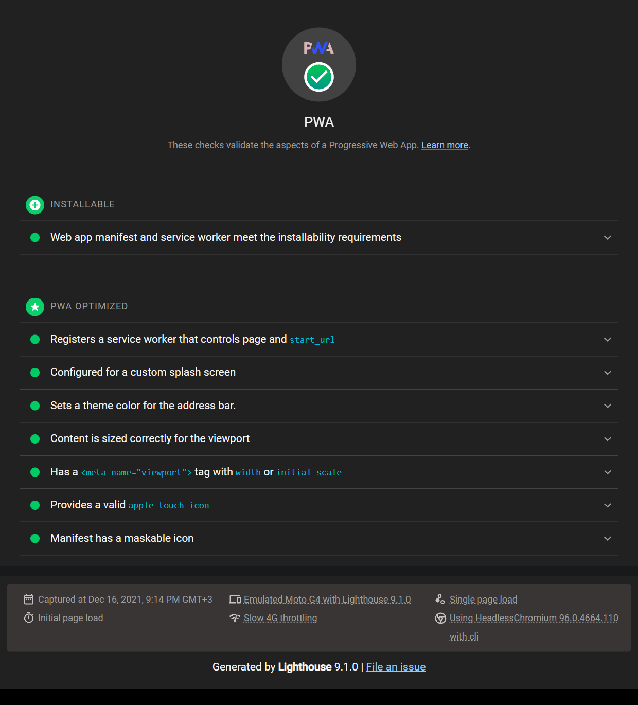

# 6. Test etmek, Lighthouse

## Lighthouse

Chrome DevTools'ta Lighthouse sekmesi var. "Progressive Web App" kategorisini seçip
çalıştır. Yüklenebilirlik için neyin eksik olduğunu tek tek yazıyor: manifest'te ikon
yok, sw fetch'e cevap vermiyor, HTTPS değil, theme-color yok gibi.

Komut satırından da çalışıyor:

```
npx lighthouse http://localhost:8000 --only-categories=pwa --view
```

`--view` raporu tarayıcıda açıyor.

`html/` klasörünün raporu:



Dikkat edilecek şey: Lighthouse'u `localhost`'ta çalıştırınca HTTPS kontrolünü geçiyor
ama gerçek sunucuda HTTP ise geçmiyor. Deploy ettikten sonra bir daha çalıştır.

Lighthouse puanı 100 olması her şeyin iyi çalıştığı anlamına gelmiyor. Sadece
"yüklenebilir" ve bazı temel şeyler. Çevrimdışıyken uygulamanın gerçekten işe yarayıp
yaramadığını elle denemen lazım.

## Gerçek telefonda denemek

Masaüstünde her şey çalışıyor görünüyor, telefonda sürpriz oluyor. Özellikle iOS.

Telefon ve bilgisayar aynı wifi'daysa bilgisayarın IP'sinden girebilirsin
(`192.168.1.xx:8000`). Ama HTTPS olmadığı için service worker çalışmıyor, sadece görünüşe
bakabilirsin.

Service worker'ı da denemek için HTTPS lazım. Ben Netlify'a atıyorum, ücretsiz ve her
push'ta otomatik deploy. `html/` klasörünü sürükle bırak ile bile yükleyebilirsin.
Alternatif olarak `ngrok` ile localhost'u HTTPS olarak dışarı açabilirsin.

Android'de USB ile bağlayıp `chrome://inspect` üzerinden telefondaki Chrome'un
DevTools'una erişebiliyorsun, console ve Application sekmesi aynen çalışıyor. Çok işe
yarıyor. iOS'ta Mac'in varsa Safari > Develop menüsünden aynı şey.

## Denemeler listesi

Benim her seferinde kontrol ettiklerim:

- [ ] Application > Manifest hatasız, ikonlar görünüyor
- [ ] Application > Service Workers'ta "activated and is running"
- [ ] Offline işaretle, yenile, sayfa açılıyor
- [ ] Offline'da bir şey ekle, online'a dön, veri duruyor
- [ ] Android'de yükle, ikona bas, adres çubuğu olmadan açılıyor
- [ ] Android'de ikon düzgün kesilmiş (maskable)
- [ ] iPhone'da Paylaş > Ana Ekrana Ekle, ikon doğru, Safari içinde açılmıyor
- [ ] Bir dosyayı değiştir, deploy et, kullanıcıya yeni sürüm ulaşıyor
- [ ] Lighthouse PWA

Son madde en önemlisi ve en çok atlananı. Her deploy sonrası yeni sürümün gerçekten
geldiğini kontrol et. HTML tarafında `CACHE` adını artırmayı unutursan gelmez.
