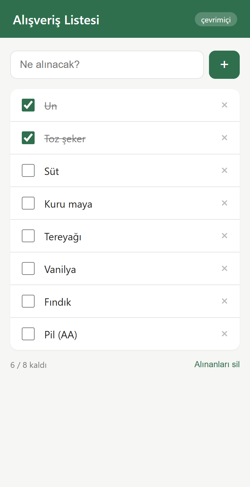
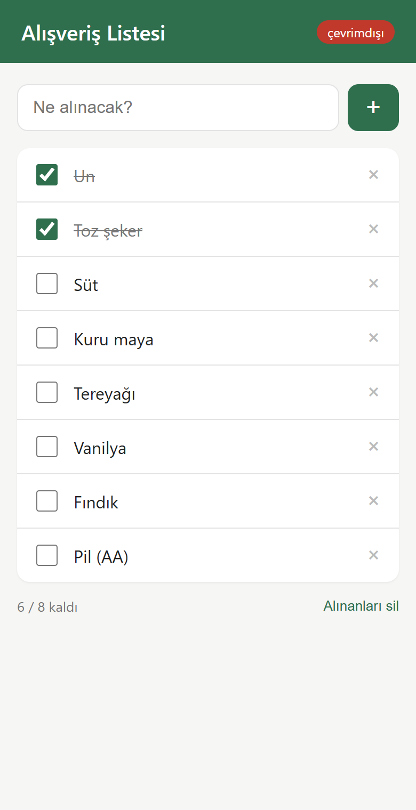

# 7. Next.js ile PWA (2026 eki)

Bu bölüm diğerlerinden beş yıl sonra, Ekim 2026'da eklendi. Bugün yeni bir React projesi
açan çoğu kişi CRA değil Next.js ya da Vite kullanıyor, o yüzden aynı liste uygulamasını
Next.js 16 ile de yazdım. Klasör: [`nextjs/`](../nextjs/)

CRA bölümünü okuduysan buradaki farklar şunlar: manifest'i Next kendisi üretiyor,
service worker'ı elle yazdım (workbox yok), ve app router'ın sunucu tarafı render'ı
yüzünden localStorage'a dikkat etmek gerekiyor.

<p>
  
  &nbsp;&nbsp;
  
</p>

## Manifest

Ayrı bir `manifest.json` yok. `app/manifest.ts` dosyası bir fonksiyon export ediyor,
Next onu `/manifest.webmanifest` adresinde sunuyor ve `<head>`'e linkini kendisi ekliyor:

```ts
import type { MetadataRoute } from "next";

export default function manifest(): MetadataRoute.Manifest {
  return {
    name: "Alışveriş Listesi",
    short_name: "Liste",
    start_url: "/",
    display: "standalone",
    theme_color: "#2f6f4e",
    background_color: "#f6f6f4",
    icons: [ /* 192, 512, maskable */ ],
  };
}
```

Tipli olduğu için alan adını yanlış yazınca TypeScript hata veriyor, JSON'da bu yoktu.

iOS meta etiketleri ve theme-color `app/layout.tsx` içindeki `metadata` ve `viewport`
nesnelerinden geliyor. `appleWebApp: { capable: true, title: "Liste" }` eski
`apple-mobile-web-app-capable` etiketini üretiyor. Elle `<meta>` yazmaya gerek yok.

## Service worker

`public/sw.js` düz bir dosya, [`html/sw.js`](../html/sw.js)'e benziyor ama bir fark var.
Next'in ürettiği js/css dosyaları `/_next/static/` altında ve adları hash'li
(`main-app-3f2a9c.js` gibi). Build almadan adlarını bilmiyorsun, dolayısıyla kurulumda
listeleyip önbelleğe alamıyorsun.

Çözüm iki parçalı:

- `/_next/static/` ve `/icons/` altındaki istekler için cache-first. Hash'li dosyanın içeriği
  değişince adı da değiştiği için eski önbellek hiçbir zaman yanlış dosya vermiyor.
- Sayfa istekleri (`request.mode === "navigate"`) için network-first. İnternet varsa yeni
  sayfa, yoksa önbellekteki son hali. Sayfa açılınca ihtiyaç duyduğu statik dosyalar
  zaten ilk kuralla önbelleğe girmiş oluyor.

Yani ilk ziyarette sayfa ve onun çektiği her şey saklanıyor, ikinci ziyaretten itibaren
çevrimdışı açılıyor. Ekran görüntüsündeki çevrimdışı hali tam bu.

Kayıt işini `components/SwKayit.tsx` yapıyor: `"use client"` bir bileşen, `useEffect`
içinde `register("/sw.js")` çağırıyor, hiçbir şey render etmiyor. Layout'a bir kere
koyuyorsun, her sayfada çalışıyor. Sadece production'da; dev'de `return`.

`next.config.ts` içinde `/sw.js` için `Cache-Control: no-cache` header'ı var. Chrome
güncelleme kontrolünde sw dosyası için HTTP önbelleğini zaten atlıyor, ama araya giren
bir CDN ya da proxy eski dosyayı tutmasın diye ekledim. Next'in kendi PWA rehberi de
aynısını öneriyor.

Workbox ya da Serwist kullanmadım. Bu kadar küçük bir uygulama için 60 satırlık düz sw
yeterli ve ne yaptığı belli. Büyük bir projede, özellikle route çoksa, `@serwist/next`
mantıklı; Next'in kendi dokümanı da onu öneriyor. Turbopack ile de çalışan örnekleri var.

## localStorage ve hydration

CRA'da `useState(okuListe)` ile başlamıştık. Next'te bu patlıyor: sayfa önce sunucuda
render ediliyor, orada `localStorage` yok. Sunucu boş liste gönderiyor, tarayıcı dolu
liste render ediyor, React "sunucuyla eşleşmiyor" diye hydration hatası veriyor.

Çözüm: boş başla, `useEffect` içinde oku:

```ts
const [liste, setListe] = useState<Oge[]>([]);
const [hazir, setHazir] = useState(false);

useEffect(() => {
  setListe(okuListe());
  setHazir(true);
}, []);
```

`hazir` bayrağı iki iş görüyor: ilk render'da "Liste boş" yazısı bir an görünüp
kaybolmasın, ve ilk `useEffect` boş listeyi localStorage'a yazıp gerçek veriyi ezmesin.

Aynı sebeple `useCevrimici` de `true` ile başlıyor, `navigator.onLine`'ı mount'ta okuyor.

## Çalıştırmak

```
cd nextjs
npm install
npm run dev      # sw kapalı
npm run build
npm start        # localhost:3000, sw açık
```

Doğrulama diğer bölümlerle aynı: DevTools > Application > Manifest'te "Installability"
boş olmalı, Service Workers'ta "activated", Offline işaretleyip yenileyince açılmalı.
Lighthouse'ta artık PWA kategorisi yok (2024'te kaldırıldı), o yüzden Application sekmesi
tek adres.

## Vercel'e atarken

Hiçbir ayar gerekmiyor. `public/sw.js` kökten sunuluyor, header'lar `next.config.ts`'ten
geliyor, HTTPS hazır. Push ettikten sonra telefonda aç, "Ana ekrana ekle" butonu
geliyorsa tamam.

`output: "export"` ile statik çıktı alıyorsan `headers()` çalışmaz, o header'ı sunucu
tarafında (Netlify `_headers`, nginx vs.) vermen gerekir. Sw'nin kendisi aynen çalışır.
